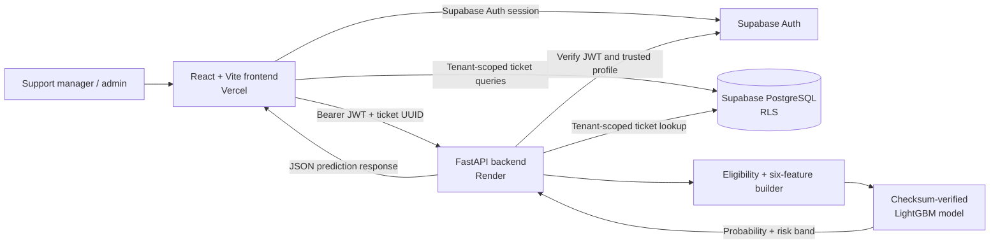

# SLA Guardian AI

**Research-stage SLA breach prediction for customer-support teams.** A full-stack web application that helps managers identify open support tickets at risk of missing their resolution Service Level Agreement (SLA) deadline.

[**Live application**](https://sla-guardian-ai.vercel.app) · [**API health**](https://sla-guardian-ai.onrender.com/health) · [**API documentation**](https://sla-guardian-ai.onrender.com/docs)

> **Research prototype, not a production-validated decision system.** Predictions are advisory, are not saved to the database, and should not be used as the sole basis for operational decisions. Access requires an authorized account; no public demo credentials are provided.

## The problem

Support teams handle tickets with different priorities and resolution deadlines. Managers need to know which unresolved tickets might miss their SLA **before** a breach occurs, rather than relying only on overdue-ticket reports.

SLA Guardian AI combines a ticket-monitoring interface with a calibrated research LightGBM classifier. Eligible managers and admins can request an estimated breach probability for a ticket with an assigned SLA policy and future deadline.

## Features

- **Authentication:** Supabase email/password login, session restoration, and logout.
- **Organization-scoped tickets:** Ticket visibility is constrained by Supabase PostgreSQL Row Level Security (RLS).
- **Role-aware access:** Manager and Admin roles can request predictions; Agent requests are blocked by the backend.
- **SLA monitoring:** View ticket priority, category, status, and resolution deadline; search and filter visible tickets.
- **On-demand ML inference:** Call an authenticated FastAPI endpoint to receive a breach probability and risk band.
- **Explainable output boundaries:** Show model version, prediction status, and a research-only disclaimer. A feature-level explanation is not claimed in the deployed UI.
- **Responsive interface:** Clean, light dashboard with mobile navigation and sign-out controls.

## System architecture



**Security boundary:** The frontend does not choose the organization or role for prediction authorization. The backend resolves these from the authenticated Supabase user profile and uses a tenant-scoped repository. A publishable Supabase key is used client-side; service-role/secret keys must never be exposed in the browser.

## Technology stack

| Layer | Technology |
| --- | --- |
| Frontend | React, Vite, Tailwind CSS, Recharts |
| Backend API | Python 3.13, FastAPI, Uvicorn |
| ML | LightGBM, scikit-learn, pandas, NumPy, joblib |
| Database and authentication | Supabase PostgreSQL, Supabase Auth, RLS |
| Model training | Google Colab |
| Hosting | Vercel (frontend), Render (backend), Supabase Cloud |
| Source control | Git and GitHub |

## Machine-learning model

The versioned model, **`phase4_research_v1`**, uses LightGBM with sigmoid probability calibration. Training and evaluation were performed in a research workflow, not on live production workloads.

**Six inputs at prediction time:**

1. `priority`
2. `category`
3. `ticket_age_hours`
4. `remaining_sla_hours`
5. `created_hour`
6. `created_weekday`

The backend uses a checksum-gated loader in `backend/ml/artifact_loader.py`, metadata in `ml/artifacts/model_metadata.json`, and the serialized classifier in `ml/artifacts/breach_classifier.joblib`. The loader validates the artifact hash and Python/ML dependency versions before deserialization.

### Research test-set results

| Metric | Result |
| --- | ---: |
| ROC-AUC | **0.7832** |
| Average precision (PR-AUC) | **0.6357** |
| Brier score | **0.1834** |
| High-risk threshold | **0.70** |
| Precision at threshold | **72.07%** |
| Recall at threshold | **6.47%** |
| Test cases | **3,348** |

**Critical limitation:** Recall at the 0.70 threshold is low. A low/medium risk band does **not** mean a ticket is guaranteed to meet its SLA. The historical IT incident cohort and provisional SLA assumptions may not represent real commercial support operations.

## API

`GET /health` — service health check.

`POST /api/v1/tickets/{ticket_id}/predict` — authenticate the bearer token, resolve the trusted profile, load the ticket within the authenticated organization, check role and SLA eligibility, and run on-demand inference.

The response includes `ticket_id`, `model_version`, `prediction_timestamp`, `sla_deadline`, `breach_probability`, `risk_band`, `prediction_status`, `research_only`, and `sla_breached`. A successful research prediction has `research_only: true`; results are not persisted.

**Relevant error responses:** missing/invalid bearer authentication (401), forbidden role (403), missing or inaccessible ticket (404), ineligible ticket (409), unavailable research model (503). Exact errors depend on the request state.

## Run locally (Windows PowerShell)

**Requirements:** Python **3.13** (the verified loader checks its major/minor version), a compatible Node.js version for the installed Vite release, npm, and access to a separately configured Supabase test project.

### Backend

From the repository root:

```powershell
py -3.13 -m venv backend\.venv-ml
.\backend\.venv-ml\Scripts\python.exe -m pip install -r backend\requirements.txt
```

Ensure `backend/requirements.txt` includes `-r requirements-ml.txt` so inference dependencies are installed. In the terminal that will run the API:

```powershell
$env:SUPABASE_URL = Read-Host 'Supabase project URL'
$env:SUPABASE_ANON_KEY = Read-Host 'Supabase publishable key'
$env:FRONTEND_ORIGIN = 'http://localhost:5173'
.\backend\.venv-ml\Scripts\python.exe -m uvicorn app.main:app --app-dir backend --host 127.0.0.1 --port 8000
```

Open `http://127.0.0.1:8000/health` or `/docs`. You must provision organizations, trusted profiles, SLA policies, and tickets in Supabase for authenticated ticket workflows; see [Supabase setup](Docs/phase5/supabase_setup.md). Never commit passwords, JWTs, `.env.local`, or service-role keys.

### Frontend

From a second PowerShell terminal:

```powershell
cd frontend
Copy-Item .env.example .env.local
notepad .env.local
npm install
npm run dev
```

Set `VITE_SUPABASE_URL` to the Supabase URL, `VITE_SUPABASE_PUBLISHABLE_KEY` to its publishable key, and `VITE_API_BASE_URL` to `http://127.0.0.1:8000`. Then open `http://localhost:5173`.

**Build and test:**

```powershell
# Run from the repository root
.\backend\.venv-ml\Scripts\python.exe -m pytest backend\tests -q
cd frontend
npm run build
npm audit --omit=dev
```

Latest reported local verification: **41 backend tests passed**, frontend build successful, and frontend production-dependency audit reported **zero known vulnerabilities** at the time checked. These observations are not a guarantee of future security.

## Deployment

| Component | Public location / configuration |
| --- | --- |
| React frontend | [sla-guardian-ai.vercel.app](https://sla-guardian-ai.vercel.app) |
| FastAPI backend | [sla-guardian-ai.onrender.com](https://sla-guardian-ai.onrender.com) |
| Supabase | Managed PostgreSQL, Auth, and RLS; project keys configured as environment variables |

**Render (repository-root deployment):**

- Root directory: repository root (blank in Render configuration).
- Build command: `pip install -r backend/requirements.txt`.
- Start command: `uvicorn app.main:app --app-dir backend --host 0.0.0.0 --port $PORT`.
- Configure `PYTHONPATH=/opt/render/project/src` and a compatible `PYTHON_VERSION` in the 3.13 series; the model loader checks the Python major/minor and exact recorded ML package versions.
- Set `SUPABASE_URL`, `SUPABASE_ANON_KEY` (publishable key), and `FRONTEND_ORIGIN=https://sla-guardian-ai.vercel.app`.

**Vercel:** Set project root to `frontend`, framework Vite, build command `npm run build`, output `dist`. Configure `VITE_SUPABASE_URL`, `VITE_SUPABASE_PUBLISHABLE_KEY`, and `VITE_API_BASE_URL=https://sla-guardian-ai.onrender.com` for Production. Vite environment variables are incorporated at build time, so redeploy after changing them.

**Deployment verification:** The deployed React application authenticated a manager, loaded Supabase tickets, and displayed a live FastAPI/LightGBM prediction after fixing CORS and model dependency packaging. Render's free instance may sleep during inactivity, causing cold-start latency.

## Development phases

| Phase | Work completed | Status |
| --- | --- | --- |
| **1 — Product requirements** | Defined resolution-SLA use case, tenant isolation, roles, and architecture | Complete |
| **2 — Foundation** | Initial FastAPI/React repo structure and developer setup | Complete |
| **3 — Dataset research** | Provisional SLA labeling, data checks, feature dictionary, time-aware splits | Complete (research) |
| **4 — ML research** | LightGBM training, calibration, test evaluation, versioned artifact | Complete (research) |
| **5 — Backend integration** | Trusted loading, SLA rules, Supabase Auth/RLS, tenant-bound FastAPI prediction | Complete for MVP |
| **6 — Frontend** | Login, tickets, on-demand prediction UI, clean responsive design | Complete for MVP |
| **7 — Validation** | 41 backend tests; live role/tenant denial checks; browser, build, and mobile tests | Complete for MVP |
| **8 — Deployment & handoff** | Render + Vercel deployment, live authenticated inference, documentation, demo guide | Complete for research MVP |

For earlier project details, refer to the existing PRD, research notebooks, and `Docs/` and `supabase/migrations/` directories. Research documentation describes provisional assumptions and should not be interpreted as a production model validation.

## Screenshots

Screenshots should use the **latest deployed interface** and a non-sensitive demo account. See [Screenshot checklist](docs/PHASE8E_SCREENSHOTS.md) for the recommended four captures: login, overview, tickets, and predictions. Avoid displaying real customer data, passwords, access tokens, or browser Developer Tools authorization headers.

## Security and limitations

- JWT validation, trusted-profile role lookup, and tenant-bound database queries were exercised in integration tests. This is **not** an independent security audit.
- Supabase RLS separates organizations; Manager/Admin prediction permission is enforced by the backend, not only by hiding a button.
- The model is research-only and may be poorly calibrated for new organizations or different SLA policies.
- No periodic scoring, prediction history, automated alerts, monitoring/observability, retraining pipeline, or SLA impact study is implemented.
- Free-hosting resources may delay responses or impose memory constraints; availability and latency are not guaranteed.
- The public application requires authorized credentials. Do not publish actual test-user passwords or invite access to a shared demo account without appropriate controls.

## Demo / interview walkthrough

See [Two-minute demo and Q&A](docs/PHASE8E_DEMO_GUIDE.md) for a non-technical explanation, a live walkthrough, talking points on ML evaluation, and clear answers about research limitations.

---

**SLA Guardian AI is a deployed, end-to-end research MVP—not a production-proven SLA decision engine.**
